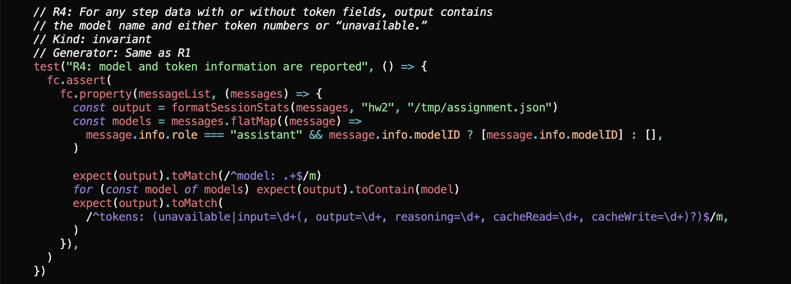

# Traceability: Kyle Luo (kyleluo)

**Target feature:** Session Stats (.opencode/command/stats.md, .opencode/plugin/session-stats.ts)

## Requirements

| ID | Interview evidence | Requirement | Acceptance Criteria | Changed in P4? | Property (kind) | Test | Mutants it kills |
|---|---|---|---|---|---|---|---|
| R1 | “negative steps or prompts or save to a file that doesn’t exist” (C1) | When /stats is run, negative values and missing assignment JSON files must be handled without corrupting the summary. | A negative prompt or metric value is rejected, and an assignment JSON file is created when it does not already exist. | No | Invariant | For any message sequence, prompt count, assistant step count, token counts, and cost are all greater than or equal to 0; missing assignment files are created and existing files remain valid JSON. | H1, H3 |
| R2 | “Because it’s sending to a TA, if there’s no output, there’s no point in collecting it, so the assistant steps can be ignored. But the cost might be worth looking at.” (C3-C4) “I would want the prompt rollback to not count. But there’s no right or wrong answer. On the other side, even if it doesn’t change anything in the source code, it could count the tokens.” (S10-S11) | /stats should count the cost of cancelled prompts but should not count cancelled prompts in the prompt counter. | After a cancelled prompt is appended, total cost does not decrease and the prompt count does not increase. | Yes | Metamorphic | Appending a cancelled prompt never decreases cost and never changes the prompt count. | H2 |
| R3 | “Renaming the assignment…takes the aggregate of all the windows together.” (C5-C7) | A session may contain only one assignment summary; attempting to rename it in the same session must provide guidance to finish the current assignment or continue later. | When /stats is called with a different assignment name in a session that already has an assignment, it fails with: “Only one assignment per summary. Complete the assignment in one session terminal or press –continue to come back to the session later.” | No | Invariant | For any two distinct assignment names in one session, the second call fails with the exact message: “Only one assignment per summary. Complete the assignment in one session terminal or press –continue to come back to the session later.” | H4 |
| R4 | “I might also want to see tokens instead of monetary cost” (C8) “Right now it’s just prompts and cost. Also I should know the model used…” (S4-5) | Add model information, including the model name and token usage, without relying on model resources. | The model name is included for every model, and token counts are included when available; otherwise the response displays “unavailable.” | No | Invariant | For any step data with or without token fields, output contains the model name and either token numbers or “unavailable.” | H5 |
| R5 | “Is there a reason for calling the model then? I think you could just have it call the plugin…” (O-3) | The stats plugin should be callable directly rather than only through a /stats command that invokes the model. | The plugin works without a /stats call, and the same statistics feature can be activated through another direct mechanism. | No | Invariant | Calling the plugin directly produces the same statistics as the equivalent /stats invocation without making a model call. | |

Properties written or suggested by opencode or another AI tool: <list by requirement ID, or "none">

R1
R2
R3
R4

## Requirement changes

| ID | Original requirement (P3) | Revised requirement | Why it changed |
|----|-------------|--------|-----------|
| R4 | Model name is included for 100% of the models. Token count is included in the response for 90% of models. | Show the model name and tokens when the step data actually provides them, and show "unavailable" otherwise. | This is now a testable version of what the users wanted (seeing tokens instead of dollars, and to know the model). |
| R5 | Plugin works without /stats. | Stats are computed and written by the event hook (on session.idle), with no model call. /stats is removed. | /stats is a tool, so it HAS to call the model. This new requirement is just elaborating on how it will change. Furthermore, there was no need for the .json, since users did not mention they were going to use it even once in the interviews. Therefore, model invocation is unneeded. However, this is not implemented as it is the highest-cost fix out of the five new requirements. |

## Hand-written mutants

| ID | Requirement targeted | Change | Predicted killer | Predicted result and reasoning | Actual result |
|---|---|---|---|---|---|
| H1 | R1 | `session-stats.ts`: cost no longer goes through `finiteNonNegative`, so a negative or `NaN` cost comes in to the total. | R1 "stats are never negative" | Killed: the R1 generator includes negative integers and `NaN`, so `cost` becomes negative or `NaN`. | Killed by R1 and R2. R1 fails on the negative/`NaN` cost; R2 also fails because `NaN >= NaN` is false. |
| H2 | R2 | `session-stats.ts`: cancellation detection compares the error name to `"MessageAborted"` instead of `"MessageAbortedError"`. | R2 "cancelled prompts preserve prompt count and cost" (`after.prompts === before.prompts`) | Killed: Prompt count increases now that it can't tell an error occured (and cancel happened). | Killed by R2 |
| H3 | R2 | `session-stats.ts`: cost sums only parts that had tokens (`tokenParts`) instead of all step-finish parts, so a cancelled step that has a cost but no tokens contributes nothing to the overall cost. | None predicted | Survives, because the R2 property only checks that cost does not decrease after a cancelled prompt. `after.cost >= before.cost` makes this mutant fine, even though the requirement says to count it. | Killed after strengthening. R7 appends a `step-finish` part that has a positive cost and no tokens, so the `tokenParts`-based reducer fails to add the expected cost. |
| H4 | R3 | `session-stats.ts`: `assignmentConflict` compares trimmed, lowercased names, so distinct names that differ only in case or surrounding whitespace no longer conflict. | None predicted | Survives because the R3 generator creates arbitrary distinct strings. | Killed after strengthening. R3b generates `hw${n}` versus ` HW${n} `, which the trimming/lowercasing comparison treats as the same name and therefore no longer reports as a conflict. |
| H5 | R4 | `session-stats.ts`: `hasTokens` uses `steps.length` instead of `tokenParts.length`, so a session with steps but no token payload prints numeric zeroes instead of `"unavailable"` like specified in R4. | None predicted | Survives, because the R4 regex accepts 0s even when there's no actual token data. | Killed after strengthening. R4 now asserts the exact token line, so a session with a step but no token payload must print `tokens: unavailable` instead of the mutant's numeric zeroes. |

Commands: `cd packages/opencode && bun test test/student/session-stats.property.test.ts` 
Reverted with `git checkout -- .opencode/plugin/session-stats.ts`.

## Stryker Comparison

**Which of your hand-written mutants did Stryker never generate? Why not?**

Stryker did not generate any of H1, H3, H4, H5 exactly. Its mutation operators made local syntax edits, so the hand-written mutants make semantic substitutions:

- **H1** replaces `finiteNonNegative(part.cost)` with `part.cost ?? 0`. Stryker did mutate the condition inside `finiteNonNegative`, but it did not replace a helper call like I did.
- **H2** changes the error string from `"MessageAbortedError"` to `"MessageAborted"`. Stryker's string-literal operator only blanks strings (`""`), so it does not invent another non-empty string (but spirtually it generated this one).
- **H3** changes the cost reducer from `steps` to `tokenParts`, but Stryker never swaps one variable for another.
- **H4** adds `.trim().toLowerCase()` to both sides of the assignment comparison. Stryker does not synthesize method calls or method chains.
- **H5** changes `tokenParts.length` to `steps.length`. This is another cross-variable substitution, so Stryker does not generate it.

**Which Stryker survivors would you never have thought of? Are any of them bugs a real developer might plausibly write?**

I would not have thought of the following:

- **`assignmentConflict`, line 8 (`&&` → `||`)**: `existing !== undefined || existing !== requested` is something that could be written by a person. This returns the conflict message when a session has no assignment yet, because `existing !== requested` is true for `undefined`. R3 generator never checks `existing === undefined`.

- **`hasTokens` mutants, line 85**: `true` and `tokenParts.length >= 0` always take the token-number branch and print `input=0, output=0, ...` instead of `"unavailable"`. That directly violates R4, but the R4 regex accepts zeroes.

- **`finiteNonNegative` `false ? value : 0`, line 38**: this turns every metric into zero, however, R1 only lower-bounds the metrics and R4 accepts zero token values, so neither property notices that it's just fully zeroes.

**What does each approach find that the other doesn't?**

Hand-written mutants can find requirement-level syntax bugs, such as returning the wrong error string, wrong variable, forgetting a helper, etc.

Stryker does a lot more syntax flips on conditions, operators, string literal changes, and whole-statement/object removals. It also produces many equivalent or irrelevant mutants because it does not know the requirements, so many mutants are unfixable even if I made changes to the assertions. 

## Final mutation score

| Run | Mutation score | Killed | Survived | Timeout | No coverage | Errors |
|---|---|---|---|---|---|---|
| Initial (weak properties) | 43.17% | 60 | 79 | 0 | 0 | 0 |
| Final (strengthened properties) | **93.53%** | **130** | **9** | 0 | 0 | 0 |

**** 130 / 139 = **93.53%** 

**Score with equivalent mutants excluded:** 130 / (139 − 9) = 130 / 130 = **100.00%**.

All mutants (H1–H5) were killed. 

### Equivalent mutants

1. **Line 38:3 — `typeof value === "number"` replaced by `true`.** This asks “is this a number” and then asks “is it a real number (not `NaN` or `Infinity`)?” Only a real number can pass the second question, so removing this check and it still working isn't actually a real mutant.

2. **Line 38:58 — `value >= 0` replaced by `value > 0`.** These two checks disagree only when the value is exactly zero. In that one case the old code returns `0` and the new code also returns `0`.

3. **Line 47:11 — `[]` replaced by `["Stryker was here"]`.** This line adds a fake name, `"Stryker was here"`, which the generator pretty much never generates randomly.

4. **Line 53:50 — the `""` fallback replaced by `"Stryker was here!"`.** This fallback is used only when a user message has no ID, but I only tested real parent IDs, so it contains neither of those strings

5. **Line 66:46 — `part.tokens?.input` replaced by `part.tokens.input`.** `part.tokens` is always present here.

6. **Line 67:48 — `part.tokens?.output` replaced by `part.tokens.output`.** Same reason as #5: the earlier filter makes sure `tokens` exists, so the `?.` never skips anything. 

7. **Line 68:54 — `part.tokens?.reasoning` replaced by `part.tokens.reasoning`.** Same reason again: `tokens` is guaranteed to exist, so the `?.` is never used. 

8. **Line 69:54 — `part.tokens?.cache` replaced by `part.tokens.cache`.** Again, the first `?.` is the one on `tokens`, and `tokens` is always present here, so it never does anything. 

9. **Line 70:56 — `part.tokens?.cache` replaced by `part.tokens.cache`.** Exactly the same as #5-8: `tokens` always exists here

## Agent failure case

"Please help me generate property tests based on this exact comment block:
// R4: For any step data with or without token fields, output contains
// the model name and either token numbers or “unavailable.”
// Kind: invariant
// Generator: Same as R1"



**The mutant it let survive**

`hasTokens: tokenParts.length > 0` → `hasTokens: true` at line 85. 

This was the Stryker one, but the hand-written H5 mutant did the same thing where it still accepted `input=0, output=0, reasoning=0, cacheRead=0, cacheWrite=0` instead of `tokens: unavailable`.

**An explanation of why the property was too weak**

The original R4 property only checked two regexes:

```ts
expect(output).toMatch(/^model: .+$/m)
expect(output).toMatch(
  /^tokens: (unavailable|input=\d+(, output=\d+, reasoning=\d+, cacheRead=\d+, cacheWrite=\d+)?)$/m,
)
```

The token regex says “numbers or `unavailable`”, but it never says *when* each one is allowed. Fake zeroes are still numbers, so the mutant passed. 

**Your strengthened version, and evidence that it kills the mutant**

The new R4 works out `hasTokens` directly from the messages and asserts the complete expected output:

```ts
const hasTokens = messages.some((message) =>
  message.parts.some((part) => part.type === "step-finish" && part.tokens),
)
const tokenLine = hasTokens
  ? `tokens: input=${stats.inputTokens}, output=${stats.outputTokens}, reasoning=${stats.reasoningTokens}, cacheRead=${stats.cacheReadTokens}, cacheWrite=${stats.cacheWriteTokens}`
  : "tokens: unavailable"

expect(formatSessionStats(messages, assignment, saved)).toBe(
  [/* every expected line, including tokenLine */].join("\n"),
)
```

Evidence:

- Applying `mutants/kyleluo/H5.patch` and running the property file now fails: **H5 is killed**.
- The four Stryker mutants at line 85 (`true`, `false`, `>= 0`, `<= 0`) no longer appear in the survivor report.
